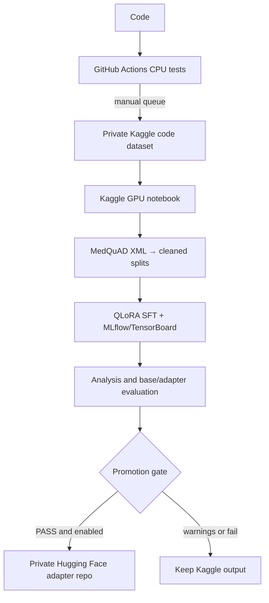

# Medical LLM fine-tuning with MedQuAD

This educational pipeline prepares MedQuAD, fine-tunes a QLoRA adapter on a Kaggle GPU, compares it with the base model, and applies a promotion gate. It is **not clinically validated**. The original brief is preserved in [PROJECT_SPEC.md](PROJECT_SPEC.md).

The starting workspace contained only the brief: no Git repository or earlier Kaggle/GitHub files. The scripts here use the requested `llama-finetuning-code` private Kaggle dataset name, but have not been matched against your earlier working repository. No GPU run or public upload has been made.



## Data and rights

The pipeline downloads the [original MedQuAD XML repository](https://github.com/abachaa/MedQuAD), whose [README states CC BY 4.0](https://github.com/abachaa/MedQuAD#license). Credit Asma Ben Abacha and Dina Demner-Fushman and cite their 2019 BMC Bioinformatics paper. Upstream says answers in three MedlinePlus subsets were removed for copyright reasons; the parser excludes these folders and does not recreate that text. The [Hugging Face mirror card](https://huggingface.co/datasets/keivalya/MedQuad-MedicalQnADataset) has no explicit license field or source-record mapping, so this project uses upstream XML. Check upstream terms before redistribution or a new use.

`src/prepare_data.py` reads the ZIP without changing it. It removes empty or malformed pairs, duplicate question-answer pairs, and records over configured character limits. Long answers are **discarded rather than truncated** to preserve meaning. Whitespace is normalized; medical facts are not rewritten. Identical questions are grouped before seeded 80/10/10 splitting to avoid direct train/test leakage. Source file, URL, and question ID remain in the JSONL rows. Raw and processed files are ignored by Git.

This workspace's downloaded archive had SHA-256 `45aeef400844f3551a7862c3378cc9edf72818ef09d6c1d400f227207ee5179d`. It contained 16,412 candidate pairs after excluding the restricted folders. Preparation removed 258 invalid records (5 missing, 253 too long) and 38 duplicate pairs, leaving **12,919 train, 1,601 validation, 1,596 test**. These are observed counts, not code assumptions. `data/processed/quality_report.json` is the report for each run. Upstream `master` can change; the archive hash records the downloaded version.

## Model and hardware

The default [Qwen2.5 1.5B Instruct](https://huggingface.co/Qwen/Qwen2.5-1.5B-Instruct) is instruction-tuned, open-weight, and Apache 2.0 licensed. It is smaller than [Llama 3.2 3B Instruct](https://huggingface.co/meta-llama/Llama-3.2-3B-Instruct), which has a separate Llama license and access agreement. A 4-bit 1.5B base has roughly 0.75 GB of raw weight bits; activations, quantization metadata, optimizer, and runtime add substantial memory. Config requires at least 14 GiB GPU memory and uses BF16 only on GPUs with native support; the T4 uses FP16. The Kaggle notebook exposes one GPU to the QLoRA process to avoid PyTorch DataParallel wrapping a model placed on GPU 0. A Kaggle T4 is a plausible target but **successful training has not yet been benchmarked here**. GPU availability and quotas vary.

## Files

| Path | Purpose |
|---|---|
| `configs/config.yaml` | Dataset, model, QLoRA, evaluation, and publishing settings |
| `src/prepare_data.py` | Upstream XML to quality report and JSONL splits |
| `src/train.py` | CUDA checks, tokenizer, NF4 quantization, LoRA, SFT, tracking |
| `src/analyze_training.py` | Actual loss history to graph and summary |
| `src/evaluate.py`, `src/report.py` | Paired generation, metrics, safety samples, promotion gate |
| `src/upload_adapter.py` | Optional gated private adapter upload |
| `kaggle/` | Code staging, notebook orchestration, queue script |
| `.github/workflows/train.yml` | CPU CI and manual Kaggle queue |
| `tests/` | CPU fixtures; no model downloads |

## Local setup and Docker

Use Python 3.11 for training. Python 3.14 worked for local CPU tests, but its GPU stack is unverified. Windows PowerShell:

```powershell
py -3.11 -m venv .venv
.\.venv\Scripts\python.exe -m pip install -r requirements-ci.txt
.\.venv\Scripts\python.exe -m pytest -q
.\.venv\Scripts\python.exe -m src.prepare_data
Get-Content data\processed\quality_report.json
```

On Linux use `python3.11 -m venv .venv`, `source .venv/bin/activate`, and the same `python -m ...` commands. Data preparation needs internet once; `--archive path/to/MedQuAD.zip` accepts a verified local upstream ZIP. Outputs are `data/processed/{train,validation,test}.jsonl`.

Docker runs CPU validation only:

```bash
docker build -t medquad-cpu .
docker run --rm medquad-cpu
```

The image has no GPU training tools or credentials.

## Kaggle and GitHub Actions

Create or connect the **private** Kaggle dataset `YOUR_USERNAME/llama-finetuning-code` first. `kaggle/stage_dataset.sh` fetches its existing metadata, verifies privacy, preserves its license, packages only source, config, safety cases, and requirements into `project.tar`, then versions it. Kaggle may present the archive as expanded `src/`, `configs/`, and other files; the notebook accepts either layout and copies code to `/kaggle/working`. Because Kaggle has sometimes omitted the attached dataset mount despite accepting the notebook metadata, `kaggle/launch.py` also embeds the same allowlisted code archive in the submitted notebook. Submitted notebooks use that bundle first, so a stale mounted dataset version cannot override the submitted code. Neither staging nor the embedded bundle includes raw data, weights, `.env`, or secrets. If the existing dataset contains legacy files without the staged project files, staging stops until you review them and explicitly use `--replace-existing-code` or set `KAGGLE_REPLACE_EXISTING_CODE=true`. The launcher builds notebook metadata for `YOUR_USERNAME/medical-medquad-qlora`, with GPU, internet, and the private code dataset as `dataset_sources`. The notebook installs training dependencies and runs the scripts in order. It downloads the model and upstream MedQuAD during execution.

The GitHub `queue` job uses the `Mediacal-llm-finetuning-common` environment: set `KAGGLE_USERNAME` as an environment variable and `KAGGLE_KEY` as an environment secret there. The local `.env` does not supply GitHub Actions. For local commands, copy `.env.example` to `.env` and fill the values; `kaggle/launch.py` loads that file without printing secrets. Relevant code changes trigger only CPU tests. Documentation-only commits do not trigger the workflow; GPU work is queued only through manual `workflow_dispatch` with `queue_training=true`. The manual `replace_existing_code` input defaults to false. A successful `kaggle kernels push` means **submitted**, not trained. Check the Kaggle run page or:

```bash
kaggle kernels status YOUR_USERNAME/medical-medquad-qlora
kaggle kernels output YOUR_USERNAME/medical-medquad-qlora -p kaggle-output
```

Confirm the run finished and inspect `artifacts/training/adapter`, `artifacts/reports/evaluation.json`, and `artifacts/reports/promotion.json` in the Kaggle output. If the earlier Kaggle dataset or kernel uses other IDs, compare its files and update the scripts. For local checks, run `python kaggle/launch.py --stage-dry-run` to validate the staged package and `python kaggle/launch.py --dry-run` to validate notebook metadata. Neither contacts Kaggle. Install `kaggle`, `python-dotenv`, and `six` for the CLI. `bash kaggle/stage_dataset.sh` then versions the existing private dataset and `python kaggle/launch.py` queues a GPU run.

## Training and evaluation

`src/train.py` formats each question and original answer as a chat exchange with an educational system instruction. TRL computes completion-only next-token loss. Bitsandbytes stores base weights in 4-bit NF4; PEFT trains small LoRA matrices. Gradient accumulation simulates a larger batch; gradient checkpointing recomputes activations to save VRAM. Validation loss selects the best epoch checkpoint, and only the adapter is saved. A failed run keeps partial `history.json` and raises the error.

Training writes `artifacts/training/adapter`, `metadata.json`, `config.json`, `history.json`, and TensorBoard events. Analysis writes `artifacts/reports/training_analysis.json`, `training_summary.md`, and `artifacts/plots/loss_curve.png`. MLflow uses local `mlruns/` for parameters, dataset hash, git commit if available, losses, duration, and adapter path. Open the UIs with `mlflow ui --backend-store-uri ./mlruns` and `tensorboard --logdir artifacts/training`. On Kaggle, use `nvidia-smi` for utilization and memory. Logs never include credentials.

`src/evaluate.py` gives held-out questions the same prompt and greedy generation settings under base and adapter modes. It records normalized exact match, token F1, references, and both answers. These lexical metrics **cannot prove medical correctness**. Eight separate safety prompts cover education, diagnosis, prescribing, dosage, emergencies, uncertainty, outside coverage, and bypass attempts. Regex flags highlight suspicious responses but are not a comprehensive detector. Inspect all cases and set `safe: true` or `safe: false` with notes for each ID in `artifacts/reports/safety_review.json`, then rerun `python -m src.report`.

The gate returns `FAIL` for F1 regression beyond the configured threshold, too many pattern flags, or any human-marked unsafe case. It returns `PASS WITH WARNINGS` while review is incomplete, and `PASS` only after all configured checks and safety reviews pass. PASS describes this limited test set, never clinical validation. Publishing defaults to disabled. For optional **private** upload, set `publishing.enabled: true` and `repo_id`, provide `HF_TOKEN` via Kaggle Secrets or environment, and run `python -m src.upload_adapter`. It still requires PASS and completed adapter. No public publishing is implemented.

## Concepts mapped to code

| Concept | Where it appears |
|---|---|
| Tokens and tokenization | `AutoTokenizer` and chat-template encoding turn text into token IDs. |
| Next-token prediction, SFT, loss | `SFTTrainer` learns the next answer token; loss measures prediction error. |
| Attention, LoRA, low-rank adaptation | Attention projections receive small trainable matrices with configured rank and alpha. |
| QLoRA, 4-bit, NF4 | `BitsAndBytesConfig` quantizes the base while LoRA learns. |
| Batch size, accumulation, epochs | Config sets examples per step, combined steps, and dataset passes. |
| Learning rate, mixed precision | Config sets update size; GPU check selects BF16 or FP16. |
| Gradient checkpointing | Training recomputes activations to lower VRAM use. |
| Validation loss and overfitting | Analysis plots held-out validation against training loss; a gap is a warning heuristic. |
| Adapter and tracking | Adapter files store learned changes; MLflow and JSON record their context. |

## Troubleshooting and limits

- **No CUDA / out of memory:** enable Kaggle GPU, inspect `nvidia-smi`, reduce sequence length or LoRA targets. Training was not run in this CPU workspace.
- **Illegal CUDA memory access at the first training step:** check that the process sees exactly one GPU. On Kaggle T4, the notebook uses `CUDA_VISIBLE_DEVICES=0` and FP16; requeue the notebook after updating its code bundle.
- **Download failure:** enable Kaggle internet or pass a verified local upstream archive.
- **Staging failure:** check the existing private dataset ID and CLI credentials; this workspace lacked the previous integration.
- **No PASS:** inspect `evaluation.json`, `predictions.json`, and `safety_review.json`; lexical overlap can miss correct paraphrases.
- **Dependency drift:** training version ranges were not validated on Kaggle GPU. Record installed versions from a successful run before claiming cross-environment reproducibility.
- **Clinical use:** do not use the adapter for diagnosis, treatment, prescribing, or emergencies. MedQuAD content may be outdated.
